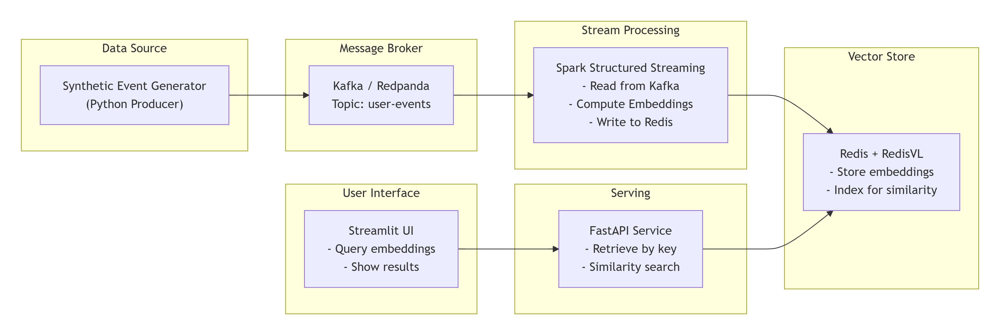

# Real‑Time Embedding Pipeline

A streaming pipeline that ingests synthetic user events, computes embeddings in real‑time, and stores them in Redis for low‑latency retrieval. Built with Kafka (Redpanda), Spark Structured Streaming, Ollama, Redis, FastAPI, and Streamlit.

---

## Table of Contents
- [Overview](#overview)
- [Architecture](#architecture)
- [Components](#components)
- [Data Flow](#data-flow)
- [Prerequisites](#prerequisites)
- [Setup & Installation](#setup--installation)
- [Running the Pipeline](#running-the-pipeline)
- [Using the Service](#using-the-service)
- [Evaluation & Testing](#evaluation--testing)
- [Troubleshooting](#troubleshooting)
- [Next Steps](#next-steps)

---

## Overview

This project demonstrates a **real‑time feature engineering pipeline** for AI/ML systems. It simulates user events (clicks, views, purchases) and transforms them into dense vector embeddings using a local embedding model. The embeddings are then stored in Redis, enabling:

- **Low‑latency retrieval** of the latest embedding for a user.
- **Similarity search** to find users with similar behavior.

The system is designed to be **cloud‑agnostic** and can be extended to handle millions of events per second by scaling Kafka and Spark.

---

## Architecture



```mermaid
graph LR
    subgraph Data Source
        A[Synthetic Event Generator<br/>(Python Producer)]
    end

    subgraph Message Broker
        B[Kafka / Redpanda<br/>Topic: user-events]
    end

    subgraph Stream Processing
        C[Spark Structured Streaming<br/>- Read from Kafka<br/>- Compute Embeddings<br/>- Write to Redis]
    end

    subgraph Vector Store
        D[Redis + RedisVL<br/>- Store embeddings<br/>- Index for similarity]
    end

    subgraph Serving
        E[FastAPI Service<br/>- Retrieve by key<br/>- Similarity search]
    end

    subgraph User Interface
        F[Streamlit UI<br/>- Query embeddings<br/>- Show results]
    end

    A --> B --> C --> D
    E --> D
    F --> E
```

*To generate a PNG image of this diagram, copy the Mermaid code into [mermaid.live](https://mermaid.live) and export as PNG.*

---

## Components

| Component            | Technology                          | Role |
|----------------------|-------------------------------------|------|
| **Event Generator**  | Python + KafkaProducer              | Simulates user events and publishes them to Kafka. |
| **Message Broker**   | Redpanda (Kafka API compatible)     | Buffers events between producer and consumer. |
| **Stream Processor** | PySpark Structured Streaming        | Consumes events, computes embeddings via Ollama, and writes to Redis. |
| **Embedding Model**  | Ollama (`nomic-embed-text`)         | Converts event text into a vector embedding. |
| **Vector Store**     | Redis (with JSON storage)           | Stores embeddings with key `user_embedding:{user_id}`. |
| **API Service**      | FastAPI                             | Provides endpoints to retrieve embeddings and find similar users. |
| **UI**               | Streamlit                           | Interactive dashboard for testing and visualization. |

---

## Data Flow

1. **Event Generation**  
   The `producer.py` script creates events every second, each containing:
   - `user_id`: randomly chosen from 100 users.
   - `timestamp`: epoch time.
   - `event_type`: one of `click`, `view`, `purchase`, `scroll`.
   - `metadata`: additional data like page visited, duration.

   Events are serialized as JSON and sent to Kafka topic `user-events`.

2. **Stream Processing**  
   Spark Streaming reads the topic in micro‑batches (every 5 seconds). For each event:
   - A text representation is built (e.g., "click on home").
   - The text is sent to Ollama’s embedding API to obtain a 768‑dimensional vector.
   - The embedding is stored in Redis with key `user_embedding:{user_id}` (overwrites previous value for that user, keeping only the latest).

3. **Serving**  
   - The FastAPI service exposes:
     - `GET /embedding/{user_id}` – returns the latest embedding for a user.
     - `POST /similar` – finds top‑k users with the most similar embedding (cosine similarity).
   - The Streamlit UI provides a user‑friendly interface to call these endpoints.

---

## Prerequisites

- **Python 3.10 or higher**
- **Docker and Docker Compose** (for running Redpanda and Redis)
- **Ollama** installed and running locally ([ollama.com](https://ollama.com))
- **Apache Spark** (to run PySpark jobs; can be installed via pip or downloaded separately)
- **Git** (optional, for cloning)

---

## Setup & Installation

### 1. Clone the Repository
```bash
git clone https://github.com/your-username/real-time-embedding-pipeline.git
cd real-time-embedding-pipeline
```

### 2. Create a Virtual Environment
```bash
python -m venv venv
source venv/bin/activate  # On Windows: venv\Scripts\activate
```

### 3. Install Python Dependencies
```bash
pip install -r requirements.txt
```

### 4. Start Infrastructure with Docker Compose
```bash
docker-compose up -d
```
This starts:
- **Redpanda** on port 9092 (Kafka API)
- **Redis** on port 6379 (with Redis Insight UI on port 8001)

### 5. Install and Run Ollama
- Download and install from [ollama.com](https://ollama.com)
- Pull the embedding model:
  ```bash
  ollama pull nomic-embed-text
  ```
- Ensure Ollama is running (by default on `http://localhost:11434`).

### 6. Configure Environment Variables
Copy `.env.example` to `.env` and adjust if needed:
```bash
cp .env.example .env
```
Default settings should work for local setup.

### 7. (Optional) Initialize Redis Vector Index
If you plan to use RedisVL for vector search, run:
```bash
python scripts/init_redis.py
```
For this MVP, the similarity search uses a simple scan‑based method (sufficient for demo).

---

## Running the Pipeline

You need to run **three processes** simultaneously (in separate terminals).

### Terminal 1: Event Producer
```bash
python src/producer.py
```
This will start generating events and sending them to Kafka. You should see output like:
```
Sent: {'user_id': 'user_42', 'timestamp': 1712345678, 'event_type': 'click', 'metadata': {'page': 'home', 'duration': 42}}
```

### Terminal 2: Spark Streaming Job
```bash
spark-submit --packages org.apache.spark:spark-sql-kafka-0-10_2.12:3.5.0 src/spark_streaming.py
```
*Note:* If you have Spark installed separately, adjust the `spark-submit` path. The command downloads the necessary Kafka package.

This job will continuously process events and store embeddings in Redis. You’ll see logs from Spark.

### Terminal 3: FastAPI Service
```bash
uvicorn src.embedding_service:app --reload --port 8001
```
The API will be available at `http://localhost:8001`.

### Terminal 4 (Optional): Streamlit UI
```bash
streamlit run app.py
```
Open the URL shown (typically `http://localhost:8501`) to interact with the UI.

---

## Using the Service

### API Endpoints

#### `GET /embedding/{user_id}`
Returns the latest embedding for a user.

**Example:**
```bash
curl http://localhost:8001/embedding/user_1
```
**Response:**
```json
{
  "user_id": "user_1",
  "embedding": [0.123, -0.456, ...]
}
```

#### `POST /similar`
Finds users with similar embeddings.

**Request:**
```bash
curl -X POST http://localhost:8001/similar \
  -H "Content-Type: application/json" \
  -d '{"user_id": "user_1", "top_k": 3}'
```
**Response:**
```json
{
  "similar_users": ["user_42", "user_17", "user_99"]
}
```

### Streamlit UI

The UI provides two tabs:
- **Get user embedding**: Enter a user ID and see the first 10 dimensions of their embedding.
- **Find similar users**: Enter a user ID and see the top‑k similar users.

---

## Evaluation & Testing

### Unit Tests
Run tests with pytest:
```bash
pytest tests/
```

### Performance Considerations
- **Embedding latency**: The current implementation calls Ollama for each event individually. For high throughput, consider batch embedding using a service like `vLLM` or a Spark UDF that processes many texts at once.
- **Similarity search**: The current endpoint scans all keys in Redis (O(n)). For large‑scale, integrate RedisVL with a vector index (HNSW) for sub‑linear search.

---

## Troubleshooting

| Problem | Possible Solution |
|---------|-------------------|
| `No module named 'pyspark'` | Install PySpark: `pip install pyspark` or use `spark-submit` from a Spark installation. |
| `Kafka connection refused` | Ensure Redpanda container is running: `docker ps`. Check ports with `docker-compose logs`. |
| `Embedding failed` | Verify Ollama is running: `curl http://localhost:11434/api/embeddings -d '{"model":"nomic-embed-text","prompt":"test"}'`. |
| `Redis connection refused` | Check Redis container logs: `docker-compose logs redis`. |
| `Spark job hangs` | Increase memory for Spark or run in local mode with `--master local[2]`. |

---

## Next Steps

- **Scale up**: Replace local Spark with a cluster (e.g., EMR, Databricks) and use Kafka in production.
- **Add more tools**: Integrate with a feature store (e.g., Feast) or use RedisVL for indexed search.
- **Extend to real‑world data**: Replace the synthetic producer with a real clickstream or IoT data source.

---

## License

MIT